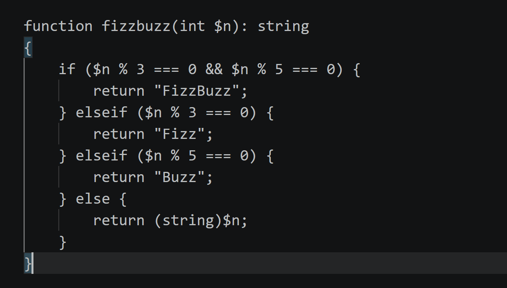

# Lab 0 submission

## Copilot suggestion screenshot

## What the app does

LinkKeeper is a small Laravel bookmark manager. It supports saving links with a title and URL, pinning or unpinning bookmarks, and displaying them in a list. `BookmarkController.php` handles listing bookmarks, creating them, and toggling pins. The `Bookmark`, `Tag`, and `User` models are in `app/Models`, the routes are in `routes/web.php`, and the page is in `resources/views/bookmarks/index.blade.php`.

The project is also a training starter for a test-driven development (TDD) lab. `app/Services/TagNormalizer.php` is deliberately unimplemented, with every method throwing an exception. The intended unit test file is `tests/Unit/TagNormalizerTest.php`, and the tag-merge cases are documented in `docs/merge-cases.md`. The controller also contains inconsistencies: `index()` sorts bookmarks in the opposite order from its docblock, and `store()` includes a “probably broken?” TODO despite appearing functional.

## Oddity found

The `Bookmark.php` docblock says `visited_at` is never null and is set on creation, but the migration allows null, `store()` does not set it, and the view handles it as “never visited.”
